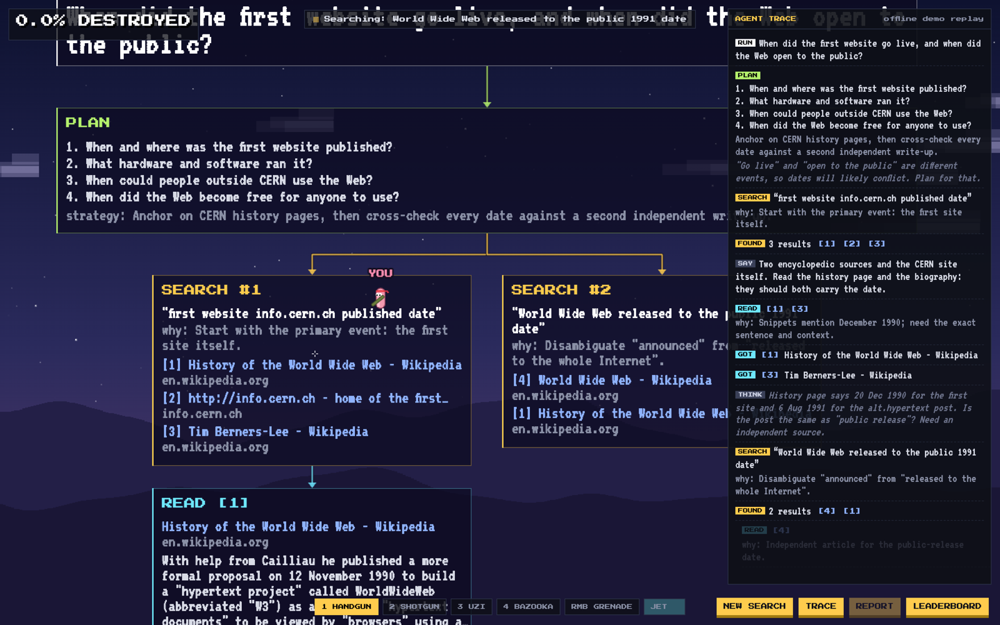
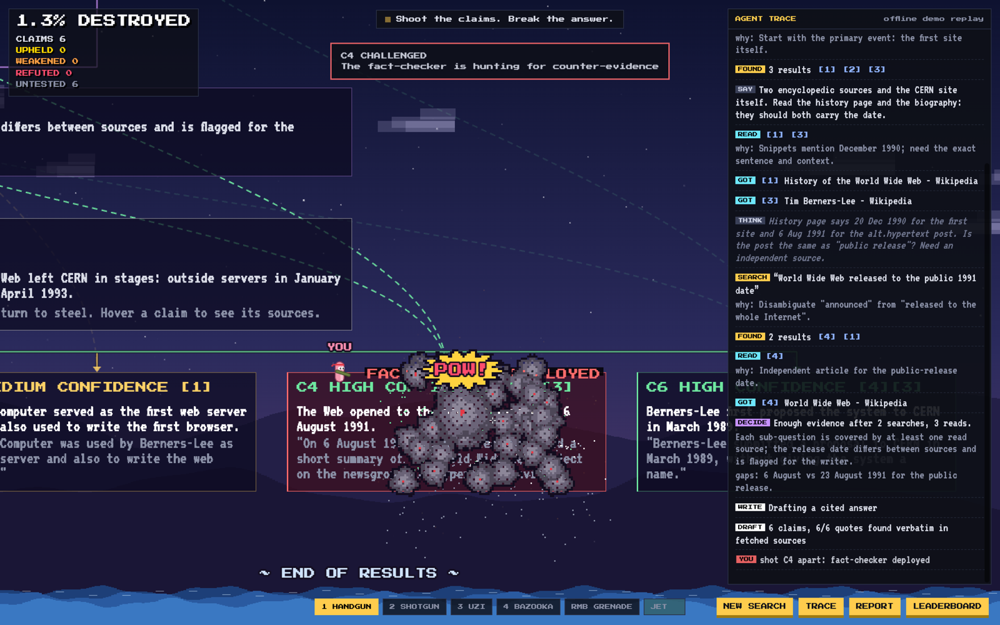
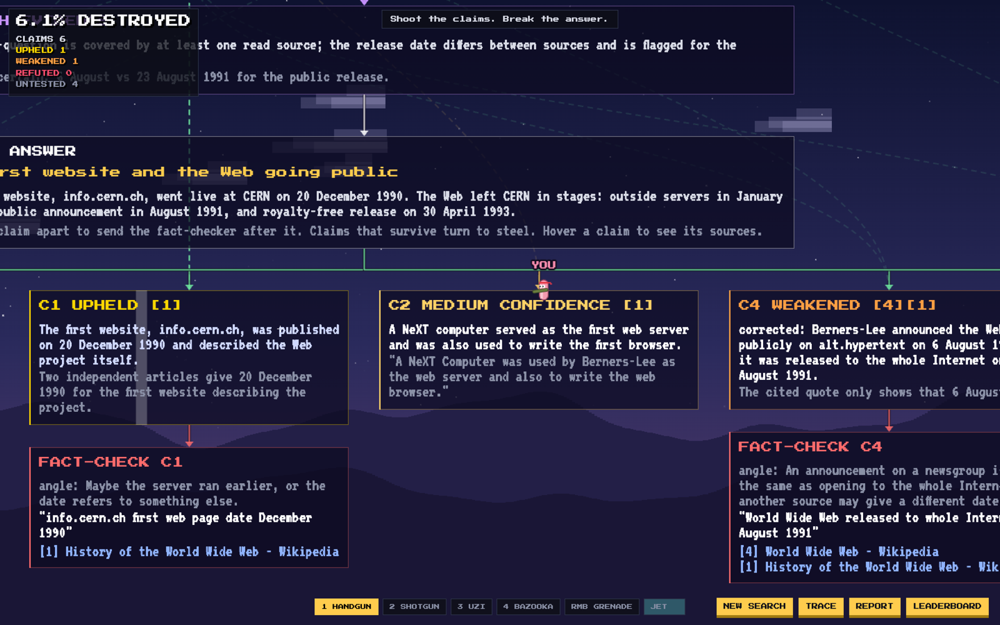
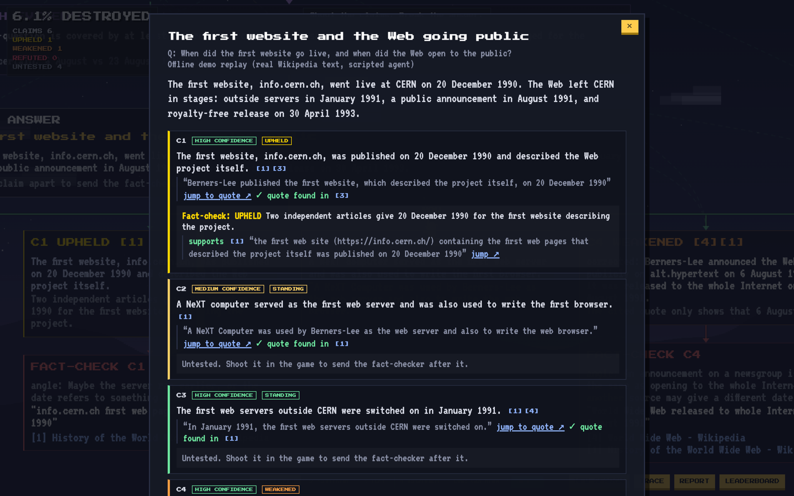
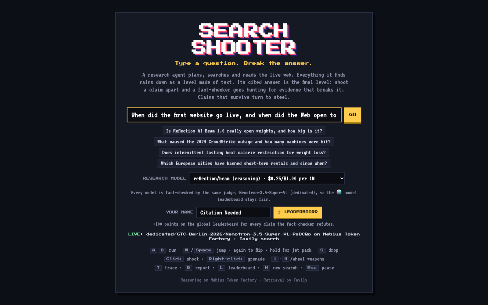
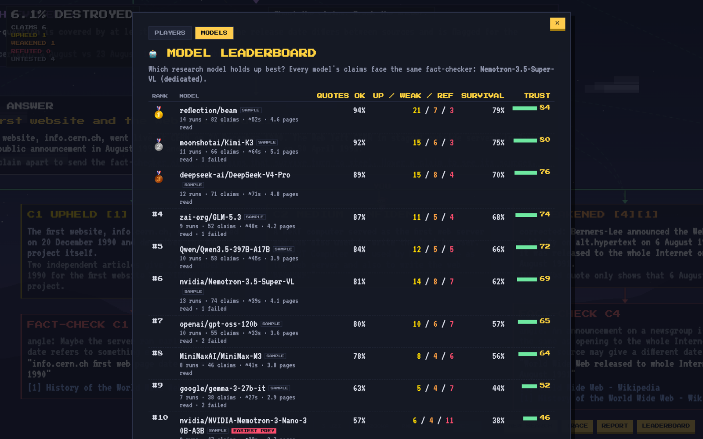

# Search Shooter

**Type a question. Break the answer.**

Search Shooter is a deep research agent that you play. It runs on **Nebius Token Factory** for reasoning and uses **Tavily** for live web search and page extraction.

1. You ask a question. The agent **plans** sub-questions, then runs a tool loop in which it decides on its own when to **search**, which pages to **read** in full, and when it has **enough evidence**.
2. Every step falls into the game as a **destructible pixel level laid out as a graph**: question → plan → searches fanning out side by side → each page read hanging under the search that found it → decision → answer → claims. The text itself is the world: every line is a one-way platform your worm can run through, land on and drop through, under a Worms-style sky with water below. Fall in the water and you respawn on the last text you stood on. Hover a claim to light up citation lines back to the sources it cites. Each fact-check appears as a new node under the claim it attacked.
3. The cited draft lands last. Each claim is a block of text with its source ids and the **verbatim quote** that supports it.
4. **Shoot a claim apart** and an **adversarial fact-checker** goes after it. It picks the angle most likely to break the claim, runs a fresh Tavily search and rules on it:
   - **UPHELD**: the block turns to gold steel and can no longer be destroyed.
   - **WEAKENED**: the block shatters and is replaced by the corrected claim.
   - **REFUTED**: the block shatters.
5. Press **R** for the verified report. Every citation links to its source, and every quote has a *jump to quote* link (a [text fragment](https://developer.mozilla.org/en-US/docs/Web/URI/Reference/Fragment/Text_fragments)) that scrolls the source page to the exact sentence. You can export the run, including the full decision trace, as Markdown or JSON.

## Screenshots

**The agent builds the level.** The plan, each search (with the reason it was run) and each page read land as text platforms in a graph. The trace panel on the right streams the agent's decisions live.



**Shoot a claim apart and the fact-checker goes after it.** Hovering a claim lights up the citation lines back to its sources.



**Verdicts change the level.** C1 survived and turned to steel; C4 was weakened and replaced by the corrected claim. Each fact-check becomes its own node.



**The verified report.** Every citation links to its source, and every quote has a "jump to quote" link that opens the page scrolled to the exact sentence.



**Pick the research model from the Token Factory catalog, then compare models on the leaderboard.** The rows tagged SAMPLE are seeded demo data, not measured results.

| Start screen | Model leaderboard |
| --- | --- |
|  |  |

The game screenshots use the offline demo replay (real Wikipedia text, scripted agent).

## Global leaderboard

Every claim the fact-checker **refutes** after you shoot it apart earns **+100 points**. Pick a name on the start screen and open the leaderboard with the 🏆 button, the in-game LEADERBOARD button, or **L**. Points are awarded on the server from the verdict, so they can't be faked from the browser. Each claim can only score once, and offline demo replays don't score. Scores are stored in `data/leaderboard.json`, so everyone playing on the same server shares one leaderboard.

## Pick the model, compare the models

The start screen has a **research model** picker filled live from the Token Factory catalog. It offers every text model that supports tool calling (Beam, Kimi, DeepSeek, GLM, Qwen, gpt-oss, Nemotron and others), with prices per million tokens. The research agent (planner, tool loop, writer) runs on the model you pick.

The fact-checker always stays on one model (`NEBIUS_CHECKER_MODEL`, default `NEBIUS_MODEL`), so every research model faces the same judge. The **MODELS** tab of the leaderboard ranks them:

| Column | Meaning |
| --- | --- |
| Quotes OK | Share of claims whose quote was found word for word in the fetched source |
| Up / Weak / Ref | Fact-check verdicts on that model's claims |
| Survival | Share of fact-checked claims that held up (weakened counts half) |
| Trust | 60% survival + 40% quotes OK, with Laplace smoothing so one lucky run can't top the table |

The model whose claims get refuted most often (minimum 3 checks) is tagged **EASIEST PREY**, so players know where the points are. Stats are stored in `data/models.json`.

### Demo seed data

```bash
npm run seed            # 12 sample players + 10 sample models, then restart the server
npm run seed -- --clear # remove them again
```

Seeded rows carry a small **SAMPLE** tag. The sample players' "last takedowns" are well-known myths, so they really are false claims. The sample model stats are **invented**, not measured, and a model's sample row is replaced by real data the first time that model is played. Seeding never overwrites real entries.

Both leaderboards live in `DATA_DIR` (default `./data`). `npm run mock` uses `data/mock/` so fake runs never touch the real boards.

## Why the citations hold up

- The writer has to copy a **verbatim quote** for each claim. The server then looks for that quote in the text Tavily actually fetched (exact match first, then a fuzzy match on 85% of the words). If the quote isn't there, the claim is flagged in the game and in the report, and its confidence drops one level.
- The fact-checker's evidence quotes go through the same check.
- `NEBIUS_CHECKER_MODEL` lets a **different model** judge the draft, so the writer doesn't grade its own work. Reflection AI's Beam is a good fit for this role.

## Why the trace shows decisions, not a script

The research loop uses native tool calling (`web_search`, `read_pages`, `finish_research`), and every call has to include a `reason`. The **AGENT TRACE** panel (press **T**) streams everything live over SSE: the plan, the model's reasoning (when the model exposes it), each search with its *why*, which pages it chose to read, when it stopped and what it is still unsure about, every attack angle the fact-checker tried, and each verdict. Budgets (6 searches, 8 page reads, 10 steps) force the model to choose instead of crawling everything.

## Run it

Requires **Node.js 21.7 or newer**. There are no dependencies to install.

```bash
cp .env.example .env      # add NEBIUS_API_KEY and TAVILY_API_KEY
npm run check             # optional: verifies both keys and the model ids
npm start                 # open http://localhost:3000
```

Without keys, the app starts in **offline demo mode**: a scripted replay built on real Wikipedia text (`agent/demo-sources.json`). Its quotes still go through the same verifier, and one of its claims is deliberately breakable. Add `?demo=1` to the URL to force demo mode even when keys are set.

### Developing without API calls

```bash
npm run mock        # app on :3000 against a local fake Token Factory + Tavily on :4010
npm run mock:dev    # same, restarting on file changes
```

`scripts/mock-server.js` speaks the same HTTP APIs as Token Factory and Tavily, so the real agent code runs unchanged: planner, tool loop with parallel tool calls, writer, quote verification, fact-checker and retries. Content is generated from your question. Page text contains the quoted sentences word for word, so citations verify. Different pages report slightly different numbers, so the fact-checker returns a mix of verdicts. The fake catalog offers three models (careful, default, sloppy) that paraphrase 0, 1 and 3 quotes per run, so the model leaderboard has something to rank. No keys are needed, and keys in `.env` are ignored.

| Variable | Default | Purpose |
| --- | --- | --- |
| `MOCK_LATENCY` | `700` | Simulated latency in ms (randomised ±50%) |
| `MOCK_FAIL_RATE` | `0` | Share (0 to 1) of JSON replies cut off with `finish_reason: length`, to test retries |
| `MOCK_PORT` | `4010` | Port of the mock APIs |

### Configuration

| Variable | Default | Purpose |
| --- | --- | --- |
| `NEBIUS_API_KEY` | | Token Factory key |
| `NEBIUS_BASE_URL` | `https://api.tokenfactory.nebius.com/v1` | OpenAI-compatible endpoint |
| `NEBIUS_MODEL` | `MiniMaxAI/MiniMax-M3` | Planner, researcher and writer |
| `NEBIUS_CHECKER_MODEL` | same as `NEBIUS_MODEL` | Adversarial fact-checker (try Beam). `npm run check` lists the Beam ids in your catalog |
| `TAVILY_API_KEY` | | Tavily key |
| `PORT` | `3000` | HTTP port |
| `DATA_DIR` | `./data` | Where the player and model leaderboards are stored |

## Controls

| Input | Action |
| --- | --- |
| `A` / `D` | run |
| `W` / `Space` | jump; press again in the air to flip, hold for the jet pack |
| `S` | drop through text |
| Mouse / click | aim / shoot |
| Right-click | grenade |
| `1`-`4` / wheel | handgun, shotgun, uzi, bazooka |
| `T` / `R` / `L` / `N` / `Esc` | trace / report / leaderboard / new search / pause |

## How it's built

```
server.js            zero-dependency HTTP server, SSE streams, run store, exports
agent/research.js    planner -> tool loop (search/read/finish) -> writer -> quote verification
agent/factcheck.js   attacker (picks the angle + query) -> Tavily -> judge
agent/sources.js     source registry, verbatim-quote verifier, text-fragment links
agent/llm.js         Token Factory client: tool calls, <think> stripping, robust JSON parsing, JSON retries
agent/tavily.js      Tavily /search and /extract
agent/demo.js        offline replay
public/js/world.js   destructible pixel terrain (solid mask + region ownership per pixel)
public/js/layout.js  graph layout: agent events -> stamped text nodes + connector/citation edges
public/js/main.js    game loop, physics, weapons, camera, SSE wiring
public/js/ui.js      HUD, trace panel, report
```

Every node is drawn into a scratch canvas and copied into the world. Strong pixels become solid terrain, and faint anti-aliased edges are kept for display only. Text works as one-way platforms: you pass through it sideways and from below, land on it from above, and drop through with S. Each pixel records which card or claim it belongs to. Explosions carve circles out of the mask, scorch a ring around the hole, and turn the removed pixels into debris. Once a claim loses about 22% of its pixels, the fact-checker is triggered.

API:

- `GET /api/research?q=…`: SSE stream of agent events
- `GET /api/challenge?run=…&claim=C3`: SSE stream of the fact-check
- `GET /api/run/:id`: JSON with the answer, claims, sources and trace
- `GET /api/run/:id.md`: the same as Markdown
- `GET /api/leaderboard?player=…`: top 20 plus your own rank
- `GET /api/models`: selectable research models (Token Factory catalog, cached 10 min)
- `GET /api/model-leaderboard`: per-model stats and trust ranking
- `GET /api/research?q=…&model=…`: `model` picks the research model (must be in the catalog)
